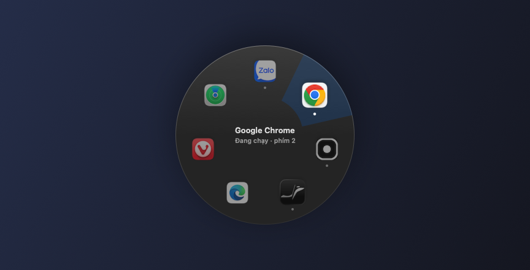
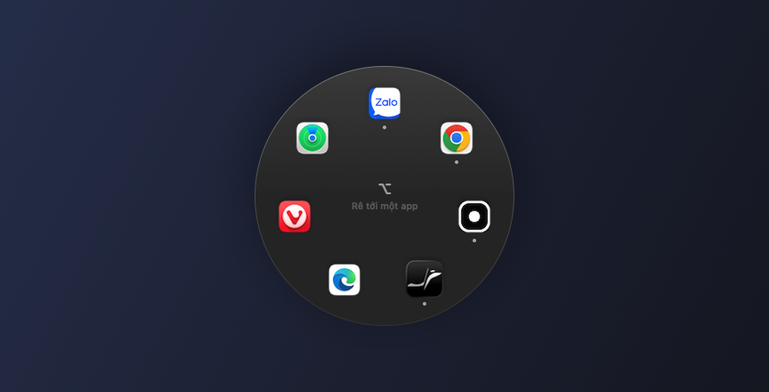
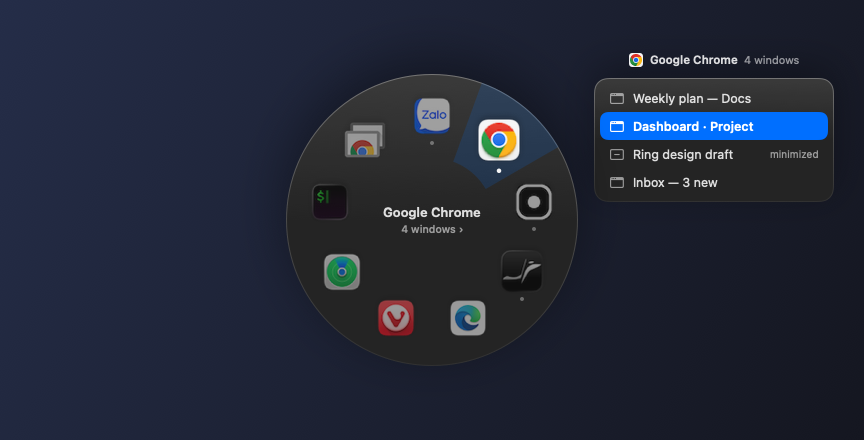
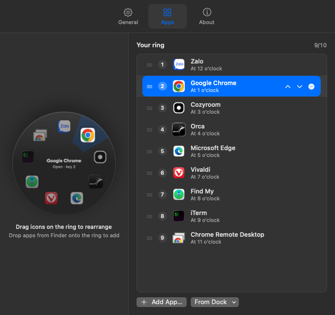
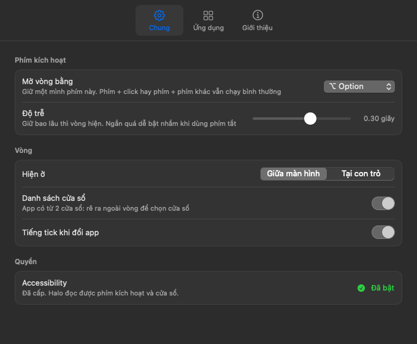

<p align="center"></p>

<h1 align="center">Halo</h1>

<p align="center"><b>Hold a key, flick toward an app, let go.</b><br>
A ring launcher for macOS that puts your favorite apps — and the exact window you want — one gesture away.</p>

<p align="center"></p>

<p align="center"><a href="#quick-start">Quick start</a> · <a href="#what-you-can-do">What you can do</a> · <a href="#limitations-and-requirements">Limitations</a> · <a href="#troubleshooting">Troubleshooting</a></p>

<p align="center"><b>English</b> · <a href="GUIDE.vi.md">Tiếng Việt</a> · <a href="README.md"><b>TL;DR</b> (1-minute version)</a></p>

## Why Halo?

You probably bounce between the same handful of apps all day: a browser, a chat app, an editor, a terminal. ⌘Tab orders apps by how recently you used them, so the one you want keeps moving and you have to look before you press. The Dock means a trip to the edge of the screen. And when an app has several windows open, ⌘Tab brings the app forward, but not necessarily the window you meant.

Halo gives each app a **fixed spot on a ring**. Hold ⌥ Option, flick the pointer toward the spot, release. Because the spots don't move, your hand learns where things are. If the app has more than one window, Halo lists them next to the ring so you can land on the right one directly.

## Quick start

There is no prebuilt download yet, so Halo is built from source on your Mac. You only need Apple's Command Line Tools, not Xcode.

**1. Install with your coding agent**

Paste this into Claude Code, Codex, Cursor, or any agent that can run terminal commands on your Mac:

```text
Install Halo, a ring launcher for macOS, from https://github.com/Rheinmir/halo.

1. Check that this Mac runs macOS 13 or later (`sw_vers -productVersion`) and has Swift
   from the Command Line Tools (`swift --version`). If Swift is missing, run
   `xcode-select --install`, ask me to finish the installer dialog, and wait for me.
2. Clone the repo into ~/halo. If ~/halo already exists, run `git pull` there instead.
3. In ~/halo, run `./build.sh`. Success ends with "selftest OK" and "OK: …/Halo.app".
   If macOS asks whether codesign may use the "Halo Local Signing" key, ask me to click
   "Always Allow". If the build fails, show me the error; don't change the code.
4. Quit Halo if it's already running (`osascript -e 'tell application id "local.halo.ring" to quit'`;
   ignore errors), then run `open ~/halo/Halo.app`.
5. Run `open "x-apple.systempreferences:com.apple.preference.security?Privacy_Accessibility"`
   and ask me to turn on Halo in that list if it isn't on already (it stays on across
   updates). Tell me Halo's Settings window shows a green "Enabled" once it's on.
6. Finish by telling me: hold ⌥ Option on its own to open the ring, move toward an app,
   release to open it.

Don't use sudo and don't install anything else.
```

✅ The agent ends with Halo running: a small ring-of-dots icon in the menu bar, and Halo's Settings window open.

<details>
<summary><b>Install manually instead</b></summary>

```bash
xcode-select --install          # skip if you already have Command Line Tools
git clone https://github.com/Rheinmir/halo.git
cd halo
./build.sh
open Halo.app
```

`build.sh` compiles the app, runs a self-test, and signs it. The first time, it also creates a local signing certificate called "Halo Local Signing" in your login keychain. If macOS asks whether `codesign` may use that key, choose **Always Allow**.

✅ A small ring-of-dots icon appears in the menu bar. Halo doesn't have Accessibility access yet, so its Settings window opens as well.

</details>

**2. Allow Accessibility access**

If you used the agent prompt, it already opened this pane for you. Just turn Halo on.

Halo needs this to notice when you hold the trigger key and to read and raise app windows.

- In Settings, open the **General** tab. Under **Permission**, click **Open Settings…**.
- In System Settings → Privacy & Security → Accessibility, turn on **Halo**.

✅ Within about two seconds, the permission row in Halo's Settings shows a green **Enabled**. You don't need to restart the app.

**3. Try it**

- Hold **⌥ Option** by itself. The ring appears in the middle of your screen.
- Move the pointer toward an app. Its slice lights up and its name appears in the center.
- Release ⌥.

✅ That app comes to the front, or launches if it wasn't running.

The ring starts with the first 8 apps pinned in your Dock. Section 4 below shows how to change them.

## What you can do

### Open an app without looking for it

Hold the trigger key, flick toward a slot, release. Apps keep their slots, so after a few days you stop looking at the ring at all.

<p align="center"></p>

- A small dot under an icon means the app is already running.
- Release in the middle of the ring (or press Esc) to cancel.
- **Space** jumps straight back to the app you were using before the current one, like a single ⌘Tab. The center of the ring shows which app that is ("Space ↩ *App*").
- Prefer the keyboard? While holding the key: **Tab / ⇧Tab** cycles, **arrow keys** pick by direction, **1–9** opens that slot, **Enter** opens the highlighted app.
- ⌥-click and ⌥ + another key still work as usual. The ring only opens when you hold the key on its own.

### Jump to the exact window

When the app you point at has two or more windows, the center reads "*N* windows ›" and a window list opens beside the ring.

<p align="center"></p>

- Keep moving outward in the same direction, past the edge of the ring. The list sits on that side, so you land in it without crossing other apps. The nearest row is selected.
- Release the key: that window comes to the front. Minimized windows (marked "minimized") are restored.
- From the keyboard: **↓** enters the list, **↑ / ↓** move through it.

### Arrange the ring by dragging

Open Settings from the menu bar icon (**Settings…**, ⌘,) and go to the **Apps** tab.

<p align="center"></p>

- **Drag an icon on the ring** to another slot. The other icons move aside, and the real ring updates as soon as you drop.
- **Drop an app from Finder** onto a slot on the ring, or between two rows of the list, to insert it right there.
- **From Dock ▾** lists every app pinned in your Dock. Apps already on the ring are checked.
- **Add App…** opens a file picker. The **−** button on a row removes that app.
- The ring holds up to 10 apps. The counter above the list shows how many slots are used (for example "7/10").

### Make it fit your hands

The **General** tab has the rest of the options.

<p align="center"></p>

| Setting | What it does |
|---|---|
| Open the ring with | Hold ⌥ Option, ⌃ Control, ⌘ Command or 🌐 Globe (fn) to open the ring |
| Delay | How long to hold before the ring appears, from 0 to 0.5 s (default 0.18 s). A short delay can trigger by accident when you use shortcuts |
| Show at | Center of the screen under the pointer, or right at the pointer |
| Window list | Turn the window list on or off |
| Tick sound | A soft tick each time the highlight moves to another app |
| Interface language | English (default), Tiếng Việt, or follow macOS |

All changes apply immediately.

## How it works

- **Everything stays on your Mac.** Halo makes no network requests and contains no web links.
- **Key detection:** a system event tap watches modifier keys. It only acts when the trigger key is held alone, and it swallows navigation keys (Tab, arrows, digits, Enter, Esc) only while the ring is open.
- **Windows:** the window list comes from the macOS Accessibility API, which is the same permission used for the key. Halo doesn't need Screen Recording.
- **Settings** are saved to `~/Library/Application Support/Halo/config.json`. You can edit the file by hand. Missing keys fall back to defaults.

## Limitations and requirements

- **macOS 13 Ventura or later.** Developed on macOS 15 (Apple Silicon). macOS 13 and 14 haven't been tried yet.
- **Accessibility permission is required.** Without it the ring never appears.
- **Build from source only.** No signed or notarized release exists yet. The app is signed with a self-signed certificate created on your own machine, so a copy of `Halo.app` won't open on another Mac. Each person builds their own.
- **Interface languages:** English and Vietnamese.
- **Up to 10 apps** on the ring.
- **The window list only shows windows on the current Space** (desktop).
- **No "launch at login" option yet.** Add Halo to System Settings → General → Login Items if you want it to start automatically.

## Troubleshooting

**Holding ⌥ does nothing.**
Accessibility is probably off. In Halo's Settings, open **General**. If the permission row doesn't show a green **Enabled**, click **Open Settings…** and turn Halo on. Also make sure you're holding the trigger key alone, and for at least the delay time.

**Accessibility keeps turning off after I rebuild.**
macOS ties the permission to the app's signature. `build.sh` signs every build with the same "Halo Local Signing" certificate so the permission sticks. If you deleted that certificate, the next build creates a new one and you need to turn Accessibility on once more.

**The Globe (🌐) key opens the emoji picker.**
macOS assigns that key to something by default. In System Settings → Keyboard, set "Press 🌐 key to" to "Do Nothing", or pick another trigger key.

**I can't find the menu bar icon.**
On Macs with a notch, icons that don't fit are hidden behind it. Quit a few menu bar apps, or ⌘-drag icons to make room. You can also open `Halo.app` again from Finder to bring up Settings.

**Halo isn't in the Dock.**
That's intentional: Halo lives in the menu bar. It shows up in the Dock and ⌘Tab only while the Settings window is open.

## Development

```bash
swift build -c release
.build/release/Halo --selftest                     # ring and window-list geometry
.build/release/Halo --preview out.png 2            # render the ring with slot 2 highlighted
.build/release/Halo --preview out.png 1 0 "A" "~B" # …plus a fake window list ("~" = minimized)
.build/release/Halo --preview-settings out.png apps|general|about [light]
# add --lang en|vi to any preview to pick the interface language
```

The screenshots in `docs/` (English) and `docs/vi/` (Vietnamese) were made with these commands. They use the apps from your own config file, and a solid background instead of the live translucent glass.

| File | Responsibility |
|---|---|
| `Sources/Halo/Hotkey.swift` | Global key detection (`CGEventTap`) |
| `Sources/Halo/Geometry.swift` | Slot and window-list geometry, self-test |
| `Sources/Halo/Ring.swift` | The ring, the window list, the floating panel |
| `Sources/Halo/Windows.swift` | Listing and raising windows via Accessibility |
| `Sources/Halo/Settings.swift` | The Settings window and the drag-to-arrange ring |
| `Sources/Halo/Apps.swift` | Config file, Dock reading, trigger keys |
| `Sources/Halo/L10n.swift` | English/Vietnamese strings (`tr("English", "Tiếng Việt")`) |
| `Sources/Halo/main.swift` | App wiring and the command-line tools above |
| `build.sh` | Builds `Halo.app`, generates the icon, signs it |

The [devlog](docs/devlog/README.md) explains the problems we hit and the design decisions behind each feature.

To remove the signing certificate later, open Keychain Access and delete "Halo Local Signing".

## License

Released under the [Apache License 2.0](LICENSE). See [NOTICE](NOTICE).
