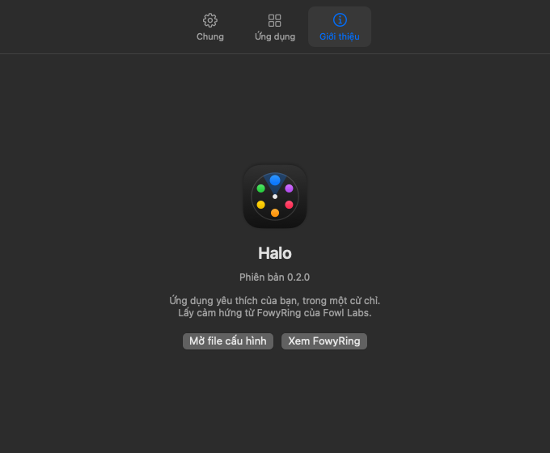
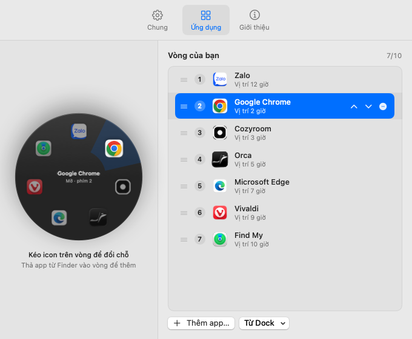
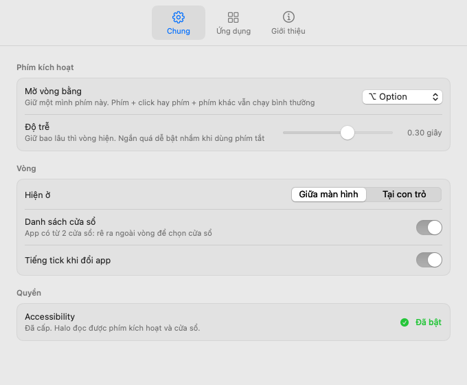
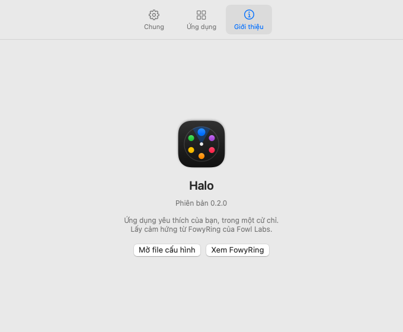

<p align="center"></p>

<h1 align="center">Halo</h1>

<p align="center">Ứng dụng yêu thích của bạn, trong một cử chỉ.<br>Launcher dạng vòng cho macOS. Lấy cảm hứng từ <a href="https://fowllabs.com/apps/fowyring/">FowyRing</a> của Fowl Labs.</p>

<p align="center"></p>

## Mục lục

1. [Cài đặt lần đầu](#1-cài-đặt-lần-đầu)
2. [Mở app bằng vòng](#2-mở-app-bằng-vòng)
3. [Chọn đúng cửa sổ](#3-chọn-đúng-cửa-sổ)
4. [Sắp xếp app trên vòng](#4-sắp-xếp-app-trên-vòng)
5. [Tuỳ chỉnh](#5-tuỳ-chỉnh)
6. [Cấu hình bằng file](#6-cấu-hình-bằng-file)
7. [Dành cho người phát triển](#7-dành-cho-người-phát-triển)
8. [Giới hạn](#8-giới-hạn)

## 1. Cài đặt lần đầu

**Bước 1. Build và mở app.** Chỉ cần Command Line Tools, không cần Xcode.

```bash
git clone https://github.com/Rheinmir/halo.git
cd halo
./build.sh
open Halo.app
```

- Lần build đầu, `build.sh` tạo chứng chỉ ký "Halo Local Signing" trong keychain.
- macOS có thể hỏi "codesign muốn dùng khoá". Bấm **Always Allow**.

**Bước 2. Cấp quyền Accessibility.** Halo cần quyền này để đọc phím giữ và danh sách cửa sổ.

- Lần đầu chưa có quyền, cửa sổ Cài đặt tự mở.
- Vào tab **Chung** → mục **Quyền** → bấm **Mở cài đặt…**.
- Trong System Settings → Privacy & Security → Accessibility, bật công tắc cạnh **Halo**.
- Đợi khoảng 2 giây. Halo tự nhận quyền, không cần mở lại app.
- Quyền được giữ qua các lần build sau, vì chữ ký không đổi.

<p align="center"></p>

**Bước 3. Tìm Halo.**

- Bình thường Halo chỉ có biểu tượng vòng chấm trên menu bar, không có icon Dock.
- Bấm biểu tượng đó → **Cài đặt…** (⌘,) hoặc **Thoát Halo**.
- Khi cửa sổ Cài đặt mở, Halo hiện trong Dock và ⌘Tab. Đóng cửa sổ thì Halo về lại menu bar, vẫn chạy nền.
- Mở `Halo.app` lần nữa khi app đang chạy: cửa sổ Cài đặt hiện lại.

## 2. Mở app bằng vòng

1. **Giữ ⌥ Option một mình.** Sau độ trễ (mặc định 0,18 giây), vòng hiện ở giữa màn hình.

   <p align="center"></p>

2. **Rê chuột về phía app.** Ô đó sáng lên, các app khác mờ đi. Tâm vòng hiện tên app và trạng thái.

   <p align="center"></p>

3. **Thả ⌥.** App đó mở ra, hoặc được đưa lên trước nếu đang chạy.

| Muốn | Làm |
|---|---|
| Huỷ | Thả ⌥ khi chuột ở giữa vòng, hoặc bấm Esc |
| Xoay qua lại giữa các app | Tab / ⇧Tab |
| Chọn app theo hướng | Phím mũi tên |
| Mở thẳng app số N | Phím 1–9 (số ghi ở tâm vòng: "phím 3") |
| Mở app đang chọn | Enter |

- Chấm nhỏ dưới icon: app đang chạy.
- ⌥-click và ⌥ + phím khác vẫn chạy bình thường, vòng không hiện.

## 3. Chọn đúng cửa sổ

Khi app đang trỏ có từ 2 cửa sổ trở lên, tâm vòng ghi **"N cửa sổ ›"** và danh sách cửa sổ bung ra cạnh vòng.

<p align="center"></p>

- Rê chuột ra **ngoài vòng** về phía danh sách. Dòng gần chuột nhất được chọn.
- Thả ⌥: đúng cửa sổ đó được đưa lên trước.
- Dùng phím: ↓ để vào danh sách, ↑ ↓ để chọn.
- Cửa sổ đang thu nhỏ (ghi "thu nhỏ") được mở ra lại.
- Rê chuột về lại trong vòng: quay về chọn app.

## 4. Sắp xếp app trên vòng

Biểu tượng Halo trên menu bar → **Cài đặt…** → tab **Ứng dụng**.

<p align="center"></p>

**Trên vòng (bên trái):**

- **Đổi chỗ:** nắm một icon, kéo sang ô khác. Icon bay theo chuột, các icon khác tự dạt ra. Thả là xong.
- **Thêm:** kéo app từ Finder, thả vào một ô trên vòng. App được chèn đúng chỗ đó.
- **Chọn:** bấm vào icon. Dòng tương ứng bên phải cũng được chọn.

**Trong danh sách (bên phải):**

- **Đổi chỗ:** kéo dòng lên xuống (nắm ở ≡), hoặc bấm ↑ ↓ hiện khi rê chuột vào dòng.
- **Xoá:** bấm −.
- **Thêm app…:** chọn một hay nhiều app trong Finder.
- Kéo app từ Finder thả vào giữa hai dòng: app được chèn đúng chỗ đó.
- **Từ Dock ▾:** liệt kê mọi app đang ghim trên Dock. Bấm app nào để thêm app đó. App đã có trên vòng hiện dấu ✓.
  - Mục cuối "Thay bằng 10 app đầu Dock": thay cả vòng.
- Vòng chứa tối đa 10 app. Số bên phải tiêu đề cho biết đã dùng bao nhiêu ô, ví dụ "7/10".
- "Vị trí 2 giờ": vị trí của app trên vòng, theo kim đồng hồ.

Mọi thay đổi có hiệu lực ngay trên vòng thật.

## 5. Tuỳ chỉnh

Tab **Chung**:

<p align="center"></p>

| Mục | Ý nghĩa |
|---|---|
| Mở vòng bằng | Phím giữ để mở vòng: ⌥ Option, ⌃ Control, ⌘ Command hoặc 🌐 Globe (fn) |
| Độ trễ | Giữ bao lâu thì vòng hiện, 0–0,5 giây. Ngắn quá dễ bật nhầm khi dùng phím tắt |
| Hiện ở | Giữa màn hình (có chuột), hoặc ngay tại con trỏ |
| Danh sách cửa sổ | Bật/tắt danh sách cửa sổ ở mục 3 |
| Tiếng tick khi đổi app | Tiếng "tink" nhỏ khi rê qua app |
| Accessibility | Trạng thái quyền. Chưa cấp thì có nút "Mở cài đặt…" |

- Chọn 🌐 Globe: nên tắt "Press 🌐 key to" trong System Settings → Keyboard. Nếu không, phím này còn mở bảng emoji.

Tab **Giới thiệu**: phiên bản, nút mở file cấu hình.

<p align="center"></p>

Cửa sổ Cài đặt theo giao diện sáng hoặc tối của macOS. Vòng luôn dùng kính tối.

<p align="center">
  
  
  
</p>

## 6. Cấu hình bằng file

Mọi thứ lưu trong `~/Library/Application Support/Halo/config.json`. Thường không cần sửa tay, vì cửa sổ Cài đặt làm được hết.

| Khoá | Giá trị |
|---|---|
| `apps` | Tối đa 10 đường dẫn `.app`. App đầu ở đỉnh vòng, theo chiều kim đồng hồ. Lần đầu lấy 8 app ghim đầu Dock |
| `position` | `"center"` hoặc `"cursor"` |
| `trigger` | `"option"`, `"control"`, `"command"` hoặc `"fn"` |
| `delay` | Số giây, từ 0 đến 0,5 |
| `windows` | `true` / `false` |
| `tick` | `true` / `false` |

File thiếu khoá nào thì khoá đó dùng giá trị mặc định. File cũ vẫn đọc được.

## 7. Dành cho người phát triển

**Yêu cầu:** macOS 13 trở lên, Swift 5.10+ (Command Line Tools). Không cần Xcode.

**Hình học vòng:**

- Đĩa 292px, icon trên vòng bán kính 104px, ô 60px, icon 44px.
- Vùng huỷ ở tâm bán kính 48px.
- Ô 0 ở đỉnh, xếp theo chiều kim đồng hồ. Chọn ô bằng `round(atan2(dx, -dy) / (2π/n))`.

**Mã nguồn** (`Sources/Halo/`):

| File | Việc |
|---|---|
| `Geometry.swift` | Hình học vòng và danh sách cửa sổ, kèm selftest |
| `Hotkey.swift` | Bắt phím toàn hệ thống bằng `CGEventTap` |
| `Ring.swift` | Giao diện vòng, danh sách cửa sổ, panel nổi |
| `Windows.swift` | Đọc và đưa cửa sổ lên qua Accessibility API |
| `Settings.swift` | Cửa sổ Cài đặt, vòng chỉnh trực tiếp |
| `Apps.swift` | Cấu hình, đọc Dock, phím kích hoạt |
| `Icon.swift` | Icon app và biểu tượng menu bar |
| `main.swift` | Nối các phần, công cụ dòng lệnh |

**Kiểm và xuất ảnh:**

- `.build/release/Halo --selftest`: kiểm hình học vòng và danh sách cửa sổ.
- `--preview out.png [ô]`: ảnh vòng.
- `--preview out.png 1 0 "Cửa sổ A" "~Cửa sổ B"`: ảnh vòng kèm danh sách cửa sổ giả. Dấu `~` = cửa sổ thu nhỏ.
- `--preview-settings out.png apps|general|about [light]`: ảnh cửa sổ Cài đặt.
- Ảnh trong README tạo bằng các lệnh trên, dùng danh sách app thật trong file cấu hình.

## 8. Giới hạn

- Ký bằng chứng chỉ tự ký "Halo Local Signing", chỉ chạy trên máy đã build. Muốn phát hành cho máy khác cần tài khoản Apple Developer để ký và notarize.
  - Gỡ chứng chỉ: Keychain Access → xoá "Halo Local Signing".
- Danh sách cửa sổ chỉ thấy cửa sổ ở Space hiện tại.
- Chưa có tuỳ chọn chạy khi đăng nhập.
- Ảnh trong README là ảnh xuất từ app với nền kính đặc. Vòng thật dùng kính mờ, thấy được màn hình phía sau.
