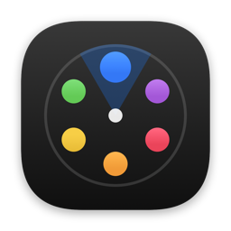
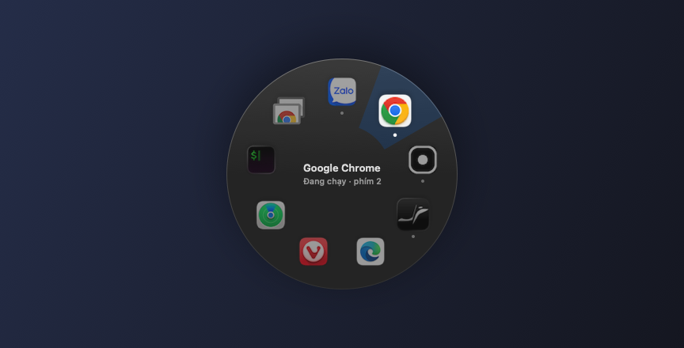
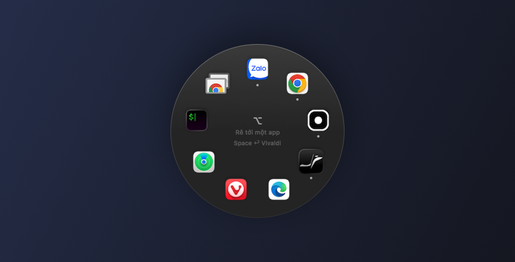
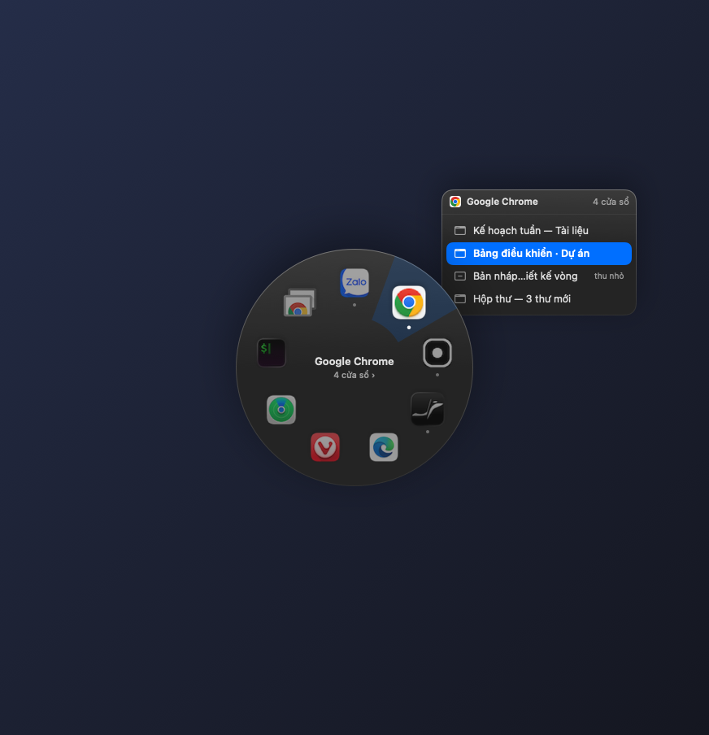
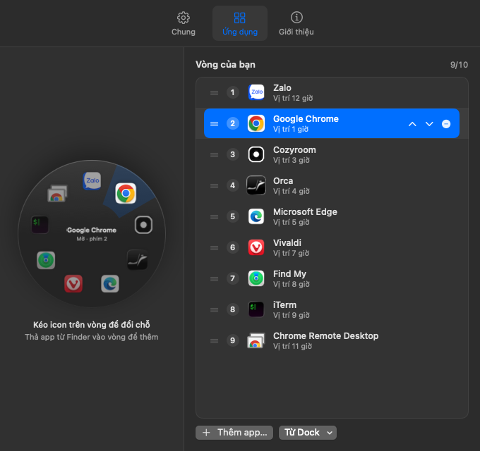
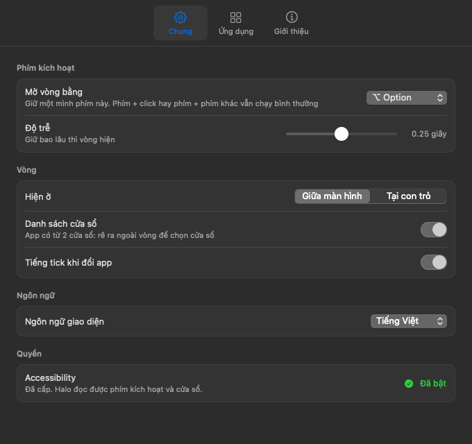

<p align="center"></p>

<h1 align="center">Halo</h1>

<p align="center"><b>Giữ phím, rê về phía app, thả tay.</b><br>
Launcher dạng vòng cho macOS: app yêu thích, kể cả đúng cửa sổ bạn cần, chỉ cách một cử chỉ.</p>

<p align="center"></p>

<p align="center"><a href="#bắt-đầu-nhanh">Bắt đầu nhanh</a> · <a href="#những-việc-bạn-làm-được">Làm được gì</a> · <a href="#giới-hạn-và-yêu-cầu">Giới hạn</a> · <a href="#xử-lý-sự-cố">Xử lý sự cố</a></p>

<p align="center"><a href="README.md">English</a> · <b>Tiếng Việt</b></p>

## Vì sao cần Halo?

Cả ngày bạn chuyển qua lại giữa vài app quen thuộc: trình duyệt, app chat, editor, terminal. ⌘Tab xếp app theo lần dùng gần nhất, nên app cần tìm cứ đổi chỗ, phải nhìn rồi mới bấm. Dock thì bắt bạn đưa chuột ra tận mép màn hình. Còn khi một app mở nhiều cửa sổ, ⌘Tab đưa app lên, nhưng chưa chắc đúng cửa sổ bạn cần.

Halo cho mỗi app **một chỗ cố định trên vòng**. Giữ ⌥ Option, rê chuột về phía chỗ đó, thả tay. Vì chỗ không đổi, tay bạn quen dần. App có nhiều cửa sổ thì Halo liệt kê chúng cạnh vòng, để bạn chọn thẳng cửa sổ cần.

## Bắt đầu nhanh

Chưa có bản tải sẵn, nên Halo được build từ source ngay trên máy bạn. Chỉ cần Command Line Tools của Apple, không cần Xcode.

**1. Cài bằng coding agent**

Dán đoạn này vào Claude Code, Codex, Cursor, hoặc agent nào chạy được lệnh terminal trên máy Mac của bạn:

```text
Cài Halo, launcher dạng vòng cho macOS, từ https://github.com/Rheinmir/halo.

1. Kiểm tra máy chạy macOS 13 trở lên (`sw_vers -productVersion`) và có Swift từ
   Command Line Tools (`swift --version`). Nếu thiếu Swift, chạy `xcode-select --install`,
   nhờ tôi hoàn tất hộp thoại cài đặt, rồi chờ tôi.
2. Clone repo vào ~/halo. Nếu ~/halo đã có, chạy `git pull` trong đó.
3. Trong ~/halo, chạy `./build.sh`. Thành công thì cuối log có "selftest OK" và
   "OK: …/Halo.app". Nếu macOS hỏi codesign có được dùng khoá "Halo Local Signing",
   nhờ tôi bấm "Always Allow". Nếu build lỗi, cho tôi xem lỗi, đừng sửa code.
4. Nếu Halo đang chạy thì thoát nó (`osascript -e 'tell application id "local.halo.ring" to quit'`;
   bỏ qua lỗi), rồi chạy `open ~/halo/Halo.app`.
5. Chạy `open "x-apple.systempreferences:com.apple.preference.security?Privacy_Accessibility"`
   và nhờ tôi bật Halo trong danh sách đó. Báo tôi rằng cửa sổ Cài đặt của Halo sẽ hiện
   "Enabled" màu xanh sau vài giây.
6. Kết thúc bằng cách hướng dẫn tôi: giữ ⌥ Option một mình để mở vòng, rê về phía app,
   thả tay để mở.

Không dùng sudo và không cài thêm thứ gì khác.
```

✅ Agent làm xong thì Halo đang chạy: có biểu tượng vòng chấm nhỏ trên menu bar, và cửa sổ Cài đặt của Halo đang mở.

<details>
<summary><b>Hoặc cài tay</b></summary>

```bash
xcode-select --install          # bỏ qua nếu đã có Command Line Tools
git clone https://github.com/Rheinmir/halo.git
cd halo
./build.sh
open Halo.app
```

`build.sh` biên dịch app, chạy selftest và ký app. Lần đầu, nó tạo thêm chứng chỉ ký "Halo Local Signing" trong login keychain. Nếu macOS hỏi `codesign` có được dùng khoá này không, chọn **Always Allow**.

✅ Một biểu tượng vòng chấm nhỏ hiện trên menu bar. Halo chưa có quyền Accessibility nên cửa sổ Cài đặt cũng tự mở.

</details>

**2. Cấp quyền Accessibility**

Nếu bạn cài bằng prompt cho agent, agent đã mở sẵn trang này. Bạn chỉ cần bật Halo.

Halo cần quyền này để biết khi nào bạn giữ phím kích hoạt, và để đọc, đưa cửa sổ lên trước.

- Giao diện mặc định là tiếng Anh. Muốn dùng tiếng Việt: tab **General** → **Interface language** → **Tiếng Việt**.
- Trong Cài đặt, mở tab **Chung**. Ở mục **Quyền**, bấm **Mở cài đặt…**.
- Trong System Settings → Privacy & Security → Accessibility, bật công tắc cạnh **Halo**.

✅ Khoảng 2 giây sau, dòng quyền trong Cài đặt của Halo hiện **Đã bật** màu xanh. Không cần mở lại app.

**3. Thử**

- Giữ **⌥ Option** một mình. Vòng hiện ở giữa màn hình.
- Rê chuột về phía một app. Ô đó sáng lên, tên app hiện ở tâm vòng.
- Thả ⌥.

✅ App đó được đưa lên trước, hoặc được mở nếu chưa chạy.

Lần đầu, vòng lấy 8 app ghim đầu tiên trên Dock. Phần "Sắp xếp vòng bằng kéo thả" bên dưới chỉ cách đổi.

## Những việc bạn làm được

### Mở app mà không phải tìm

Giữ phím kích hoạt, rê về một ô, thả tay. App giữ nguyên chỗ, nên vài hôm sau bạn không cần nhìn vòng nữa.

<p align="center"></p>

- Chấm nhỏ dưới icon: app đang chạy.
- Thả tay khi chuột ở giữa vòng (hoặc bấm Esc) để huỷ.
- **Space** đưa bạn về ngay app dùng trước app hiện tại, giống bấm ⌘Tab một lần. Tâm vòng ghi app đó ("Space ↩ *tên app*").
- Thích dùng phím? Trong lúc giữ phím kích hoạt: **Tab / ⇧Tab** xoay vòng, **phím mũi tên** chọn theo hướng, **1–9** mở thẳng ô số đó, **Enter** mở app đang chọn.
- ⌥-click và ⌥ + phím khác vẫn chạy bình thường. Vòng chỉ hiện khi bạn giữ phím một mình.

### Chọn đúng cửa sổ

Khi app đang trỏ có từ 2 cửa sổ trở lên, tâm vòng ghi "*N* cửa sổ ›" và danh sách cửa sổ bung ra cạnh vòng.

<p align="center"></p>

- Rê tiếp ra xa theo đúng hướng đó, qua mép vòng. Danh sách nằm sẵn ở phía đó nên bạn vào thẳng mà không đi qua app khác. Dòng gần chuột nhất được chọn.
- Thả phím: đúng cửa sổ đó lên trước. Cửa sổ thu nhỏ (ghi "thu nhỏ") được mở ra lại.
- Dùng phím: **↓** để vào danh sách, **↑ / ↓** để chọn.

### Sắp xếp vòng bằng kéo thả

Mở Cài đặt từ biểu tượng trên menu bar (**Cài đặt…**, ⌘,), chọn tab **Ứng dụng**.

<p align="center"></p>

- **Kéo icon trên vòng** sang ô khác. Các icon khác dạt ra, vòng thật cập nhật ngay khi thả.
- **Thả app từ Finder** vào một ô trên vòng, hoặc vào giữa hai dòng trong danh sách, để chèn đúng chỗ đó.
- **Từ Dock ▾** liệt kê mọi app đang ghim trên Dock. App đã có trên vòng có dấu ✓.
- **Thêm app…** mở hộp chọn file. Nút **−** trên mỗi dòng xoá app đó.
- Vòng chứa tối đa 10 app. Số bên trên danh sách cho biết đã dùng bao nhiêu ô, ví dụ "7/10".

### Chỉnh cho vừa tay

Tab **Chung** có các tuỳ chọn còn lại.

<p align="center"></p>

| Tuỳ chọn | Ý nghĩa |
|---|---|
| Mở vòng bằng | Giữ ⌥ Option, ⌃ Control, ⌘ Command hoặc 🌐 Globe (fn) để mở vòng |
| Độ trễ | Giữ bao lâu thì vòng hiện, từ 0 đến 0,5 giây (mặc định 0,18 giây). Ngắn quá dễ bật nhầm khi dùng phím tắt |
| Hiện ở | Giữa màn hình có chuột, hoặc ngay tại con trỏ |
| Danh sách cửa sổ | Bật/tắt danh sách cửa sổ |
| Tiếng tick | Tiếng "tink" nhỏ mỗi khi chuyển sang app khác |
| Ngôn ngữ giao diện | English (mặc định), Tiếng Việt, hoặc theo macOS |

Mọi thay đổi có hiệu lực ngay.

## Cách hoạt động

- **Mọi thứ ở trên máy bạn.** Halo không gửi request mạng nào và không chứa link web nào.
- **Bắt phím:** một event tap của hệ thống theo dõi phím bổ trợ. Nó chỉ phản ứng khi phím kích hoạt được giữ một mình, và chỉ chặn các phím điều hướng (Tab, mũi tên, số, Enter, Esc, Space) khi vòng đang mở.
- **Cửa sổ:** danh sách lấy từ Accessibility API của macOS, cùng quyền dùng cho phím. Halo không cần quyền ghi màn hình.
- **Cài đặt** lưu ở `~/Library/Application Support/Halo/config.json`. Sửa tay cũng được. Khoá nào thiếu thì dùng giá trị mặc định.

## Giới hạn và yêu cầu

- **macOS 13 Ventura trở lên.** Phát triển trên macOS 15 (Apple Silicon). Chưa thử trên macOS 13 và 14.
- **Bắt buộc có quyền Accessibility.** Không có quyền, vòng không bao giờ hiện.
- **Chỉ build từ source.** Chưa có bản ký và notarize. App được ký bằng chứng chỉ tự ký tạo trên chính máy bạn, nên mang `Halo.app` sang máy khác sẽ không mở được. Mỗi người tự build.
- **Ngôn ngữ giao diện:** tiếng Anh và tiếng Việt.
- **Tối đa 10 app** trên vòng.
- **Danh sách cửa sổ chỉ thấy cửa sổ ở Space (desktop) hiện tại.**
- **Chưa có tuỳ chọn chạy khi đăng nhập.** Muốn Halo tự chạy, thêm vào System Settings → General → Login Items.

## Xử lý sự cố

**Giữ ⌥ mà không có gì xảy ra.**
Có lẽ quyền Accessibility đang tắt. Trong Cài đặt của Halo, mở tab **Chung**. Nếu dòng quyền không hiện **Đã bật** màu xanh, bấm **Mở cài đặt…** rồi bật Halo. Cũng kiểm tra bạn đang giữ phím kích hoạt một mình, và giữ đủ lâu hơn độ trễ.

**Build lại thì quyền Accessibility bị tắt.**
macOS gắn quyền với chữ ký của app. `build.sh` ký mọi bản build bằng cùng chứng chỉ "Halo Local Signing" để quyền được giữ. Nếu bạn đã xoá chứng chỉ này, lần build sau sẽ tạo chứng chỉ mới và bạn phải bật quyền thêm một lần.

**Phím 🌐 Globe mở bảng emoji.**
macOS gán sẵn việc cho phím này. Trong System Settings → Keyboard, đặt "Press 🌐 key to" thành "Do Nothing", hoặc chọn phím kích hoạt khác.

**Không thấy biểu tượng trên menu bar.**
Ở máy có tai thỏ (notch), icon không đủ chỗ sẽ bị giấu sau tai thỏ. Thoát bớt app trên menu bar, hoặc giữ ⌘ và kéo icon để dọn chỗ. Bạn cũng có thể mở lại `Halo.app` trong Finder để hiện cửa sổ Cài đặt.

**Halo không có trong Dock.**
Đó là thiết kế: Halo sống trên menu bar. Nó chỉ hiện trong Dock và ⌘Tab khi cửa sổ Cài đặt đang mở.

## Phát triển

```bash
swift build -c release
.build/release/Halo --selftest                     # hình học vòng và danh sách cửa sổ
.build/release/Halo --preview out.png 2            # ảnh vòng, ô 2 đang chọn
.build/release/Halo --preview out.png 1 0 "A" "~B" # …kèm danh sách cửa sổ giả ("~" = thu nhỏ)
.build/release/Halo --preview-settings out.png apps|general|about [light]
# thêm --lang en|vi vào lệnh preview bất kỳ để chọn ngôn ngữ giao diện
```

Ảnh trong `docs/` (tiếng Anh) và `docs/vi/` (tiếng Việt) được tạo bằng các lệnh trên. Ảnh dùng danh sách app trong file cấu hình của bạn, và dùng nền đặc thay cho lớp kính mờ của app thật.

Code và các quyết định thiết kế được giải thích trong [devlog](docs/devlog/README.md) (tiếng Anh).

Muốn gỡ chứng chỉ ký: mở Keychain Access và xoá "Halo Local Signing".

## Giấy phép

Phát hành theo [giấy phép Apache 2.0](LICENSE). Xem [NOTICE](NOTICE).
