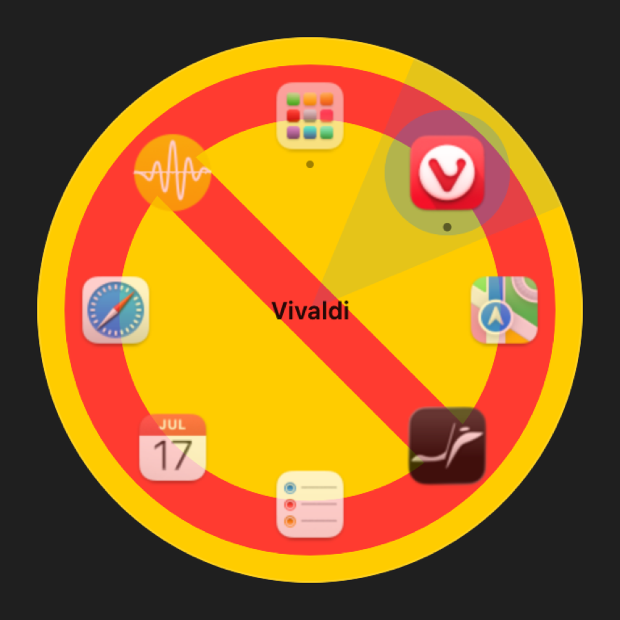

# Building a ring launcher without Xcode

*Written 2026-10-14 · Structure: feature*

## What the user needed

The starting point was a question: could we build our own version of FowyRing — a macOS launcher where you hold a key, flick toward an app on a ring, and release — and could we do it with [xtool](https://github.com/xtool-org/xtool)?

The goal was a working app on this Mac: hold a key, see a ring of favorite apps, open one by pointing at it.

## What the feature had to do

- Open the ring only when a modifier key is held **on its own**, so ⌥-click and ⌥-shortcuts keep working.
- Never steal focus from the app you are typing in.
- Map the pointer direction to a slot, with a dead zone in the middle that means "cancel".
- Activate the app (or launch it) on release.
- Live in the menu bar, with no Dock icon.

## Why this design

**xtool was the wrong tool.** Its README describes one target: "Build a SwiftPM package into an iOS app." It exists so you can build iOS apps without Xcode on Linux or Windows. We needed a macOS app, on a Mac. The machine already had Swift 6.2.3 and the Command Line Tools, which is enough to compile an AppKit app with SwiftPM. A small `build.sh` wraps the binary into `Halo.app` with an `Info.plist` (`LSUIElement` for menu-bar-only).

**A global event tap, not a hotkey API.** "Hold a modifier alone" can't be expressed as a normal hotkey. [`Hotkey.swift`](../../Sources/Halo/Hotkey.swift) installs a `CGEventTap` that sees modifier changes, key presses, mouse moves and clicks. That requires the Accessibility permission — a trade-off accepted up front.

**A short delay before showing.** When the trigger key goes down alone, Halo waits (0.18 s by default) before showing the ring. If another key or a click arrives first, the ring never appears, so ⌥ + letter and ⌥-click behave normally.

**A non-activating panel.** The ring is a borderless `NSPanel` with `.nonactivatingPanel` and `canBecomeKey = false`, so the app underneath keeps keyboard focus.

**Geometry as a pure function.** [`Geometry.swift`](../../Sources/Halo/Geometry.swift) turns `(dx, dy)` from the ring center into a slot: slot 0 at the top, clockwise, chosen by `round(atan2(dx, -dy) / (2π/n))`, with a 48 px dead zone. Keeping this free of UI made it easy to self-test.

## How it works

1. Trigger key down, nothing else held → start the delay timer.
2. Timer fires → show the panel centered on the screen under the pointer.
3. Every mouse move → recompute the slot and highlight it.
4. Trigger key up → activate the highlighted app via `NSWorkspace.openApplication`, or do nothing if the pointer is in the dead zone.

While the ring is open, the tap also swallows Tab, arrows, digits, Enter and Esc for keyboard navigation, and passes everything else through.

## Real results

- `swift build -c release` succeeds with only the Command Line Tools.
- `Halo --selftest` checks the geometry: dead zone, all four directions, wrap-around near slot 0, and slot 1 of 5 at (98.91, −32.14).
- A `--preview` flag renders the ring to PNG, so the UI can be checked without pressing keys:

An early version rendered through SwiftUI's `ImageRenderer`, which can't draw AppKit views. The translucent background showed up as a placeholder:

Previews now render through an offscreen `NSHostingView`, and use a solid background where the live app uses glass.

## Gaps

- The full hold-and-release flow has not been exercised with real key presses yet. It needs the Accessibility permission, which wasn't granted during development. See [the permission devlog](fix-accessibility-permission-lost.md).
- macOS 13 and 14 haven't been tried.
