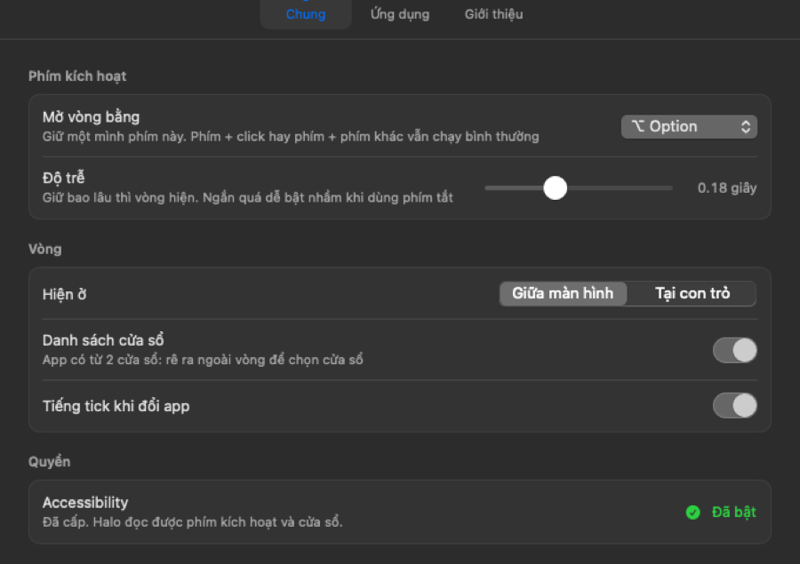

# Settings that looked adjustable but weren't

*Written 2026-10-14 · Structure: feature*

## What the user needed

"Config sao nhiều nút không chỉnh được thế" — why can't so many controls be changed?

## What was actually wrong

We tested every control through Accessibility first. The real ones worked: clicking "Tại con trỏ" changed `position` to `cursor`, and the tick toggle changed `tick` to `false`. The user's config was restored afterwards.

The problem was elements that **looked like controls but weren't**:

- The trigger key was a static "⌥ Option" chip.
- The 0.18 s delay was hard-coded.

## What the feature had to do

- Let users choose the trigger key, including 🌐 Globe like the original app.
- Let users tune the delay. Too short, and the ring triggers during normal shortcuts.
- Reflect the choice everywhere it's shown.

## Why this design

- **A fixed set of four modifiers** (⌥ ⌃ ⌘ 🌐) instead of arbitrary key recording. "Hold alone" detection works the same for any single modifier: [`Hotkey.swift`](../../Sources/Halo/Hotkey.swift) checks that the chosen flag is down and that none of the others are.
- **A 0–0.5 s slider** showing the value in seconds.
- **A hint for Globe:** macOS assigns that key to the emoji picker by default, so the row explains how to turn that off.
- The center of the ring and the menu-bar line show the chosen key's symbol.

## Real results

The new rows made the General tab taller than the window, and the tab bar was cut off at the top:

The window grew from 480 to 560 pt tall:

## Gaps

- No live key test for the new trigger keys yet, because the permission wasn't granted during development.
