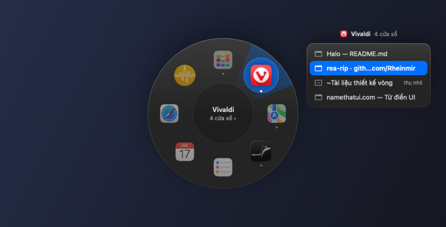
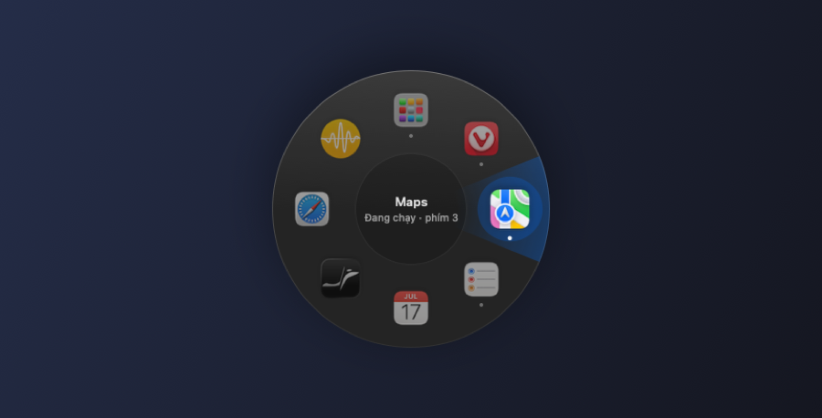
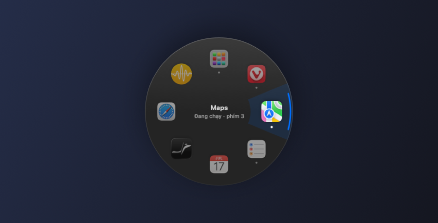
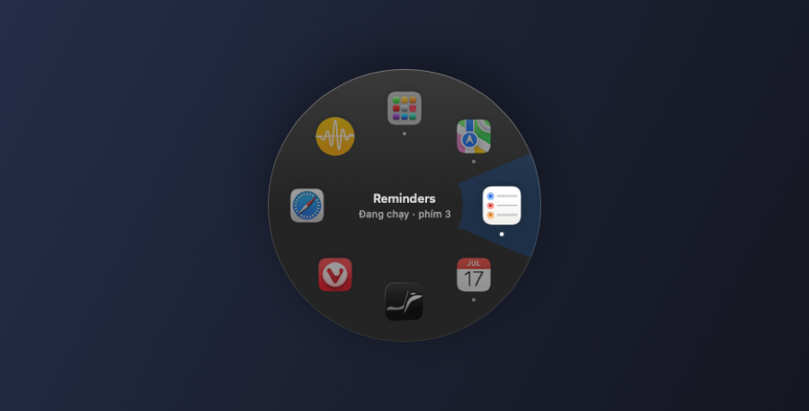

# One signal for "this slot is selected"

*Written 2026-10-14 · Structure: feature (design decision)*

## What the user needed

The user wanted to know which app they're pointing at, at a glance, without visual noise. Their reaction to the first polished version: "sao phải 2 vòng tròn khi selected" — why two circles when selected?

## What it had to do

- Show the selected slot instantly, in the direction of the pointer.
- Keep the app's own icon the most prominent thing.
- Leave the center readable for the app name.

## Why this design — and what came before

The first version stacked effects: a blurred glow, a tinted disc, a thin bright ring around the icon, a gradient wedge, and a dark hub in the center. Each looked fine alone. Together they read as concentric circles.

We removed one layer at a time, and checked each step with a render:

| Version | Change | Why it wasn't enough |
|---|---|---|
| v2 | A single tinted disc behind the icon | The disc sat where the wedge was darkest, so it still looked doubled |
| v3 | No disc. A flat wedge, plus a bright arc on the rim | The dark center hub was still a second circle |
| v4 | No center hub, and the wedge became a ring segment that stops before the center | The user asked about the blue rim arc. It wasn't needed |
| v5 | No arc | — |

  
  
  

## How it works now

- A flat, faint accent ring segment (opacity 0.16) behind the selected slot. It starts outside the center area, so the name stays clean.
- The selected icon scales to 1.14, and the others dim to 0.55.
- No glow, no disc, no outline, no hub. The dead zone still works, it just isn't drawn.

## Real results

The final state is what ships in [`Ring.swift`](../../Sources/Halo/Ring.swift). Each version above is a real render from `--preview`.

## Open questions

- Without the hub, nothing shows where the cancel zone is. Whether people miss it is untested.
